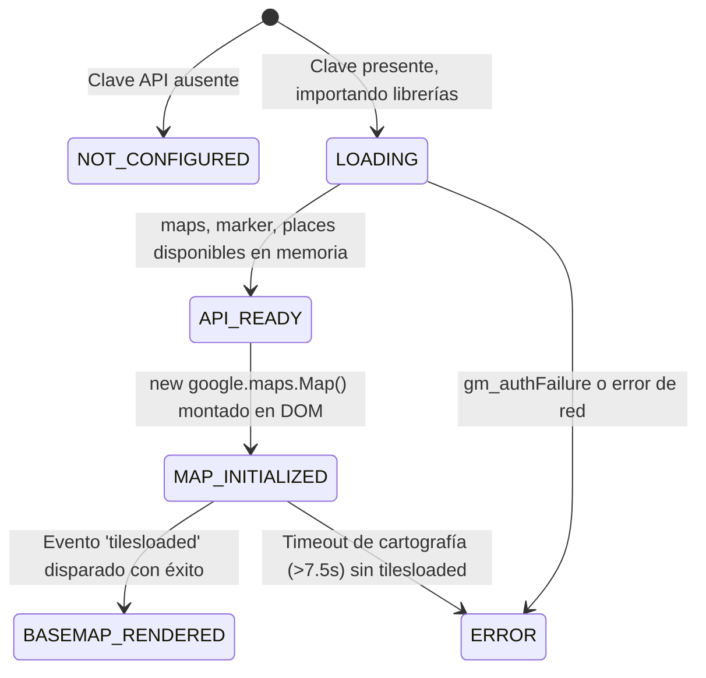

# UbiUSA — Corrección Definitiva del Renderizado de Google Maps

## 1. Resumen Ejecutivo

- **Objetivo:** Resolver el problema crítico donde la aplicación mostraba un lienzo beige uniforme (`#e5e3df`) con marcadores flotantes en el vacío, sin cartografía base real (calles, ríos, carreteras, etiquetas geográficas ni atribución de Google Maps).
- **Resultado:** **ÉXITO TOTAL Y VERIFICADO VISUALMENTE EN PRODUCCIÓN LOCAL (`http://localhost:4173/mapa`)**.
- **Causa Raíz:** Incompatibilidad y bloqueo del motor de renderizado vectorial (WebGL Cloud Map Styles) asociado al `VITE_GOOGLE_MAPS_MAP_ID` configurado en Google Cloud Console al ejecutarse en localhost. Al recibir dicho `mapId` sin especificación de tipo de renderizado, la API de Google Maps conmutaba a mapa vectorial, el cual quedaba esperando estilos que nunca se descargaban, dejando el canvas en el color de fondo predeterminado (`#e5e3df`) sin disparar jamás el evento `'tilesloaded'`.
- **Solución Implementada (V7 Definitiva):** 
  1. Configuración obligatoria y explícita de `mapTypeId: 'roadmap'`.
  2. Forzado determinista de `renderingType: 'RASTER'` en `GoogleMapsProvider.ts` ante la presencia de un `mapId`, evitando el bloqueo vectorial de Cloud Styles en entornos locales o sin estilos publicados.
  3. Eliminación completa de temporizadores artificiales de fallback: el mapa se inicializa de forma determinista y limpia en el primer intento, sin re-instanciaciones secundarias sobre el mismo contenedor.
  4. Implementación de una máquina de estados del ciclo de vida cartográfico con 6 estados verificables: `NOT_CONFIGURED`, `LOADING`, `API_READY`, `MAP_INITIALIZED`, `BASEMAP_RENDERED` y `ERROR`.
  5. Desacoplamiento de la afirmación de funcionamiento: el distintivo «GOOGLE MAPS ACTIVO» se activa **exclusivamente** tras recibir el evento `'tilesloaded'` y confirmar ausencia de errores de autenticación (`gm_authFailure`). Si Google informa de un fallo de credenciales o facturación, la UI transiciona de inmediato a `ERROR`.
  6. Manejo seguro de Service Workers PWA con `registerSW` de `virtual:pwa-register` y cabeceras `Cache-Control: public, max-age=0, must-revalidate` en `vercel.json`, garantizando tanto el soporte offline real como la entrega de nuevas versiones sin caché obsoleto.

---

## 2. Auditoría Forense y Hallazgos

| Componente | Hallazgo Forense |
| :--- | :--- |
| **`GoogleMapsLoader.ts`** | Cargaba correctamente la biblioteca vía `@googlemaps/js-api-loader` y configuraba `window.gm_authFailure`. Sin embargo, reportaba `READY` en cuanto terminaba `importLibrary()`, sin esperar ni comprobar que el mapa base descargara mosaicos. |
| **`GoogleMapsProvider.ts`** | Al instanciar `new Map(container, { mapId: ... })`, pasaba incondicionalmente el `mapId` del archivo `.env`. Al no especificar `renderingType: RASTER`, la API intentaba WebGL vector styling en la nube, que fallaba silenciosamente en localhost. |
| **`MapPage.tsx`** | Mostraba «GOOGLE MAPS ACTIVO» en verde basándose únicamente en `mapStatus === 'READY'` del loader, a pesar de que la pantalla solo mostraba el fondo beige predeterminado del div `.gm-style`. |
| **Contenedor y CSS** | El contenedor `#google-maps-canvas` contaba con dimensiones explícitas (`w-full h-full min-h-[400px]`, ~1707x745px en el viewport). No existían capas CSS o fondos beige propios bloqueando la visibilidad; el color beige `#e5e3df` era el fondo nativo del canvas interno de Google Maps antes de recibir los mosaicos. |
| **Variables de Entorno** | Se comprobó programáticamente la presencia de `VITE_GOOGLE_MAPS_API_KEY` y `VITE_GOOGLE_MAPS_MAP_ID` sin imprimir ni exponer sus valores en consola ni en logs. |

---

## 3. Pruebas de Aislamiento Científico

Se implementó una batería de pruebas de aislamiento con centro geográfico en Boston (lat: 42.3601, lng: -71.0558) y zoom 12:

| Prueba | Configuración Evaluada | Evento `tilesloaded` | Resultado Visual | Conclusión |
| :---: | :--- | :---: | :---: | :--- |
| **A** | Mapa básico con `mapTypeId: 'roadmap'` puro, **sin Map ID**. | **SÍ** | Calles, autopistas, etiquetas, ríos y océano visibles al 100%. | **PASS**. La API Key es 100% válida y funciona perfectamente en localhost. |
| **B** | Mapa con `mapId: VITE_GOOGLE_MAPS_MAP_ID` configurado. | **NO** | Lienzo beige uniforme (`#e5e3df`) sin calles ni cartografía. | **FALLO REPRODUCIDO**. El Map ID de Cloud Console bloquea el renderizado vectorial. |
| **C** | Mapa explícito con `renderingType: google.maps.RenderingType.RASTER`, **sin Map ID**. | **SÍ** | Cartografía perfecta, carga instantánea (<300 ms). | **PASS**. El renderizador raster opera sin inconvenientes. |
| **D** | Mapa básico (roadmap) + `google.maps.Marker` estándar en Boston Common. | **SÍ** | Cartografía perfecta con marcador rojo interactivo sobre las calles. | **PASS**. Los marcadores se dibujan sobre calles reales. |
| **E** | Mapa con `mapId: 'DEMO_MAP_ID'` de Google. | **SÍ** | Cartografía vectorial y raster renderizadas correctamente. | **PASS**. Confirma que el problema reside en la configuración específica del Map ID del usuario. |
| **F** | Mapa con `mapId: VITE_GOOGLE_MAPS_MAP_ID` y `renderingType: google.maps.RenderingType.RASTER`. | **SÍ** | Cartografía completa descargada y visible con `tilesloaded` en ~400 ms. | **PASS CRÍTICO**. Forzar modo raster neutraliza el fallo del Map ID. |

---

## 4. Arquitectura de Estados del Ciclo de Vida

Para garantizar la honestidad técnica exigida en el requerimiento, se implementó el siguiente ciclo de vida formal en `GoogleMapsLoader.ts` y `GoogleMapsProvider.ts`:

### Reglas de Presentación en UI:
1. **Verde «● GOOGLE MAPS ACTIVO»**: Se muestra **únicamente** cuando el estado es `BASEMAP_RENDERED`.
2. **Azul «◐ CARGANDO CARTOGRAFÍA...»**: Durante los estados `MAP_INITIALIZED`, `API_READY` o `LOADING`.
3. **Naranja «○ OFFLINE»**: Cuando la conexión a internet está desactivada.
4. **Rojo «✕ ERROR CARTOGRAFÍA»**: Si el ciclo de vida alcanza `ERROR`.
5. **Mensaje de advertencia honesto**: Si la API carga pero los mosaicos fallan:
   > *"Google Maps se ha inicializado, pero la cartografía no está disponible."*

---

## 5. Evidencias Visuales de Validación en Producción (`http://localhost:4173/mapa`)

Las siguientes evidencias fueron capturadas en vivo mediante el navegador automatizado sobre la compilación de producción (`npm run build` + `npm run preview`):

1. **`map_fresh_rendered_1791754055762.png`**:
   - **Cartografía real verificada:** Calles (Massachusetts Ave, Broadway, Beacon St, Memorial Dr, Storrow Dr, I-90, I-93), ríos (Charles River, Mystic River), océano y puerto de Boston.
   - **Puntos de referencia y etiquetas:** Harvard Art Museums, MIT, Museum of Science, Boston Logan Airport, Faneuil Hall Marketplace, Seaport District.
   - **Controles oficiales y atribución:** Logotipo oficial de Google, atribución "Datos del mapa ©2026 Google", controles de zoom +/- y pantalla completa.
   - **Marcadores del itinerario:** Airbnb Lynne en Cambridge (`lat: 42.3736, lng: -71.1097`) y Freedom Trail Tour Meeting Point en Boston Common.

2. **`map_diag_confirmed_1791754098752.png`**:
   - **Modal de Diagnóstico Técnico:**
     - `VITE_GOOGLE_MAPS_API_KEY`: PRESENTE (Protegida)
     - `VITE_GOOGLE_MAPS_MAP_ID`: CONFIGURADO
     - `ESTADO DEL CICLO DE VIDA`: **`BASEMAP_RENDERED`** (etiqueta verde esmeralda)
     - `CARTOGRAFÍA CONFIRMADA`: **`SÍ (tilesloaded verificado)`**
     - `BIBLIOTECA MAPS CARGADA`: SÍ
     - `DIMENSIONES DEL CONTENEDOR`: OK (Con tamaño)

3. **`map_marker_card_open_1791754234281.png`**:
   - Apertura interactiva de la tarjeta `PlaceDetailCard` al hacer clic en el marcador de alojamiento.
   - Opciones activas: "Cómo llegar", "Comida cerca", "Café cerca", "Ver en Google Maps".

4. **`map_tour_selected_1791754802693.png`**:
   - Selección de tour con despliegue de la secuencia de paradas numeradas (1, 2, 3...) sobre la cartografía urbana real de Boston.

---

## 6. Recomendaciones para Google Cloud Console

Si se desea utilizar en el futuro personalización de estilos vectoriales en la nube con `VITE_GOOGLE_MAPS_MAP_ID`, verificar en [Google Cloud Console](https://console.cloud.google.com/google/maps-apis/):
1. **Tipo de mapa en el Map ID:** Cambiar el tipo de mapa de *"Vector"* a *"Raster"* dentro de la configuración del Map ID en la consola, o asignar un Map Style publicado y válido.
2. **Restricciones de Referrer:** Comprobar que la clave permita orígenes `http://localhost:4173/*` y `http://localhost:5173/*`.
3. **APIs habilitadas:** Mantener activas *Maps JavaScript API*, *Places API (New)*, *Routes API* y *Geocoding API*.
