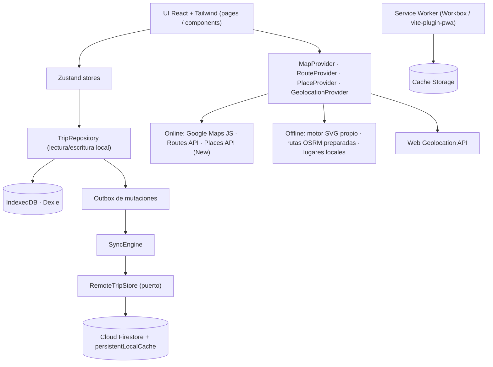

# Plan de arquitectura — USA Travel Companion · Iván & Gloria

> Fecha del plan: 2026-10-05 · Viaje: 2026-10-12 → 2026-10-29
> Pasajeros: Iván Andrés Zúñiga Romo · Gloria Marina Romo Pantoja · Origen: Cali, Colombia (CLO)

---

## A. Arquitectura general



| Pieza | Responsabilidad |
|-------|-----------------|
| **Frontend** | React 19 + TypeScript strict + Vite. Páginas: Hoy, Itinerario, Mapa, Transporte, Reservas, Pendientes, Lugares, Documentos, Configuración, Preparar viaje offline. |
| **Firebase** | Auth (Google) para identificar a los dos viajeros; SDK cargado de forma diferida. Si faltan variables `VITE_FIREBASE_*`, la app funciona en modo LOCAL sin sincronizar. |
| **Firestore** | Réplica remota compartida entre dispositivos; `persistentLocalCache` activado como segunda capa de caché. Nunca es la única copia offline. |
| **IndexedDB** | **Fuente de verdad en el dispositivo** (Dexie). Snapshot del itinerario, rutas, lugares, preferencias, outbox y estado de sync. |
| **Service Worker** | Precache del *app shell* (HTML/JS/CSS/iconos/fuentes), *runtime caching* acotado, aviso de actualización disponible. |
| **Google Maps Platform** | Solo online: mapa vectorial con `AdvancedMarker`, Routes API (`Route.computeRoutes`), Places API (New) para cercanos. |
| **Geolocation API** | `watchPosition` con alta precisión; funciona sin red (GPS del dispositivo). |
| **Motor de visualización offline** | Render SVG propio: proyección Web Mercator, puntos del día, polilínea preparada, posición GPS, escala y norte. Teselas OSM solo si ya fueron vistas (sin descarga masiva). |
| **Sincronización** | Online → Firestore → IndexedDB → UI · Offline → IndexedDB → UI · Reconexión: outbox → Firestore → resolución LWW → IndexedDB. |

Estructura de carpetas: `src/domain` (tipos y reglas puras), `src/data` (seed, Dexie, repositorio,
sync, Firestore), `src/services` (mapas, rutas, lugares, geolocalización, conectividad, preparación,
clima), `src/ui` (componentes, páginas, layout), `src/stores` (Zustand).

## B. Estrategia Offline‑First

Jerarquía implementada:

1. **Datos críticos del viaje → IndexedDB.** El JSON del viaje se transforma a modelo de dominio
   (`src/data/seed`) y se escribe en IndexedDB en el primer arranque; incluido en el bundle precacheado.
2. **Datos sincronizados de Firestore → caché persistente.** Snapshots remotos se fusionan en IndexedDB;
   además Firestore usa `persistentLocalCache`.
3. **Recursos de aplicación → Service Worker** (precache con revisión por build).
4. **Rutas preparadas → IndexedDB**, solo con contenido cuya conservación está permitida (ver C).
5. **Información dinámica → solo online**: Google Maps, tráfico, transporte en tiempo real, Places, clima.
   Se marca con la etiqueta *DINÁMICO · requiere Internet*.
6. **Sin conexión, nunca se bloquea la navegación**: todos los accesos a red están envueltos en
   adaptadores con *timeout* que devuelven estados comprensibles.

### Verificación de políticas de Google Maps Platform (consultadas 2026‑10‑05)

- Service Specific Terms (Routes / Places): solo se permite caché temporal de **latitud/longitud hasta
  30 días consecutivos**; **`place_id` puede almacenarse indefinidamente**; el resto del contenido no
  puede pre‑cargarse, cachearse ni almacenarse.
- El contenido de Google Maps **no puede usarse junto a un mapa no‑Google**.
- No se descargan teselas de Google; Google Maps **no** funciona como mapa offline en esta PWA.

**Decisión:** las rutas preparadas offline **no** usan contenido de Google. Se calculan con OSRM
sobre datos OpenStreetMap (ODbL, atribución obligatoria) y las coordenadas propias provienen de
Nominatim/OSM. De Google solo se persiste `place_id` + alias escrito por el usuario. Los resultados
de Routes API se muestran en el mapa de Google y viven en memoria.

Para los trayectos conocidos:

- Waypoints preparados (`places` con precisión `exacto` o `ciudad`).
- Rutas preparadas con Internet (botón *Preparar viaje offline*), cada una con `routePlanId`.
- Instrucciones normalizadas en español **generadas por la app** a partir de las maniobras OSRM.
- Polilínea local dibujada por el motor SVG.
- Etiqueta visible: **"Ruta preparada disponible offline"**.
- Desvío sin Internet: se muestra distancia a la ruta y rumbo; **no** se promete recálculo.
- Recálculo dinámico, tráfico y transporte público en tiempo real: requieren Internet.

## C. Estrategia de mapa offline

Interfaces comunes (`src/services/providers.ts`):

```ts
interface MapProvider      { kind: 'online' | 'offline'; isAvailable(): boolean }
interface RouteProvider    { getRoute(planId): Promise<RouteResult>; canRecalculate: boolean }
interface PlaceProvider    { getPlaces(filter): Promise<Place[]>; searchNearby?(c, cat): Promise<NearbyPlace[]> }
interface GeolocationProvider { watch(cb, err): () => void; getCurrent(): Promise<GeoFix> }
```

- **OnlineMapProvider**: `@vis.gl/react-google-maps` (`APIProvider`, `Map`, `AdvancedMarker`), `mapId`
  configurable, Routes API (TRANSIT / WALKING / DRIVING), Places API (New) `Place.searchNearby`.
- **OfflineMapProvider**: motor SVG local + teselas OSM ya vistas (si existen) + puntos del itinerario +
  rutas preparadas + GPS + instrucciones almacenadas.
- Selección automática por conectividad y disponibilidad de API key; el usuario puede forzar offline.
- La UI consume únicamente las interfaces; ningún componente de página importa Google Maps directamente.

## D. Transporte público

| Tipo | Disponibilidad | Implementación |
|------|---------------|----------------|
| Rutas preparadas | Offline | `routePlans` (OSRM, a pie / vial) |
| Horarios estáticos | Offline (enlaces + notas) | Fuentes oficiales: MBTA (Boston), MTA y PATH / NJ Transit (NYC‑Bayonne), WMATA (Washington), NFTA (Niágara), LYNX (Orlando). **No se inventan horarios**: se guardan enlaces oficiales y se indica "consultar". |
| Tiempo real | Solo online | Google Routes API modo TRANSIT. |
| Incidencias | Solo online | Enlaces a avisos oficiales de cada operador. |

## E. Firestore

```
/trips/{tripId}                                   ownerUid, memberEmails[], title, dates, dataVersion
/trips/{tripId}/travelers/{travelerId}
/trips/{tripId}/flights/{flightId}
/trips/{tripId}/accommodations/{accommodationId}
/trips/{tripId}/activities/{activityId}
/trips/{tripId}/transportLegs/{transportLegId}
/trips/{tripId}/places/{placeId}
/trips/{tripId}/routePlans/{routePlanId}          (metadatos; la geometría OSRM se mantiene local)
/trips/{tripId}/tasks/{taskId}
/trips/{tripId}/documents/{documentId}            (metadatos y notas; archivos binarios solo locales)
```

- Cada documento: `updatedAt` (ms), `updatedBy` (uid), `deleted` (bool) además de sus campos.
- Separación lectura/escritura: `RemoteTripStore.subscribe()` (listeners) vs `RemoteTripStore.write()`.
- Reglas: acceso solo si `request.auth.token.email` (verificado) ∈ `memberEmails` del viaje; creación del
  viaje solo por su `ownerUid`; validación de tipos y tamaños por colección; `updatedBy == auth.uid`.
- Índices: no se requieren compuestos (consultas por colección completa); `firestore.indexes.json` vacío
  versionado.

## F. IndexedDB (Dexie)

| Tabla | Contenido |
|-------|-----------|
| `entities` | Snapshot del itinerario: travelers, flights, accommodations, activities, transportLegs, tasks, documents (clave `[collection+id]`). |
| `places` | Lugares (coordenadas OSM, precisión, fuente, atribución, overrides del usuario). |
| `routePlans` | Rutas: waypoints, geometría, distancia, duración, instrucciones normalizadas, `preparedAt`. |
| `savedPlaces` | `place_id` de Google + alias propio. |
| `files` | Blobs de documentos locales opcionales. |
| `outbox` | Mutaciones pendientes (`pendingChanges`). |
| `meta` | `currentDay`, `currentActivity`, preferencias, `lastSyncedAt`, `syncStatus`, `dataVersion`, `deviceId`, diagnóstico de preparación, metadatos del mapa. |

## G. Sincronización

- **Online**: listener Firestore → `mergeRemote()` → IndexedDB → `liveQuery` → UI.
- **Offline**: IndexedDB → UI; escrituras → IndexedDB + outbox (estado **PENDING**).
- **Reconexión**: `online` / `visibilitychange` → `SyncEngine.flush()` → Firestore → resolución de
  conflictos → actualización local. Reintentos exponenciales (1 s → 60 s).
- **Conflictos**: Last‑Writer‑Wins por documento usando `updatedAt`; un snapshot remoto no pisa un
  documento con mutación pendiente más reciente en outbox. Las entidades semilla editables solo cambian
  `status`/`notes`; los datos de la reserva original no se sobrescriben desde la UI.
- Registro en `meta`: `lastSyncedAt`, `syncStatus` (SYNCED / SYNCING / PENDING / LOCAL), `pendingChanges`,
  `dataVersion`.

## H. Zonas horarias

Cada evento guarda `date`, `localTime`, `timeZone` (IANA) y `utc` (ISO) cuando la hora es conocida.
Conversión con `Intl.DateTimeFormat` (sin librerías). Zonas usadas:

| Lugar | Zona |
|-------|------|
| Boston, NYC/Bayonne, Washington, Niágara, Orlando, BOS, EWR, MCO | `America/New_York` |
| Cali (CLO) | `America/Bogota` |
| Ciudad de Panamá (PTY) | `America/Panama` |
| Houston (IAH) | `America/Chicago` |

Horas no exactas se marcan `timePrecision: 'aproximada' | 'flexible' | 'todo-el-dia' | 'desconocida'`.

## I. Modelo de dominio

Interfaces en `src/domain/types.ts`: `Traveler`, `Trip`, `Flight`, `FlightSegment`, `Accommodation`,
`Activity`, `TransportLeg`, `Place`, `RoutePlan`, `Task`, `TripDocument` (*Document* colisiona con el DOM),
`DayPlan`, `TimelineEvent`. IDs estables y legibles (`flight-ida-abumlb`, `act-2026-10-17-bryant-tour`…).
Estados: `confirmado | planificado | pendiente | aproximado | cancelado | realizado | en-curso | retrasado`
y marca separada de dato *dinámico*. El JSON original se conserva en `src/data/seed/tripSource.ts` y se
transforma con `buildTripSnapshot()`; la UI nunca lee el JSON directamente.

## J. Verificación

| # | Qué se demuestra | Cómo |
|---|------------------|------|
| 1 | Funciona online | E2E Playwright: carga y navegación por las 10 secciones. |
| 2 | Funciona offline | E2E: `context.setOffline(true)` + recarga → la app abre desde el SW. |
| 3 | Firestore conserva datos localmente | Integración: SyncEngine con `RemoteTripStore` en memoria → datos en IndexedDB; Firestore `persistentLocalCache` configurado. |
| 4 | SW sirve recursos | E2E: `navigator.serviceWorker.controller` activo y recarga offline exitosa. |
| 5 | IndexedDB contiene snapshot | E2E + integración: lectura de tablas Dexie. |
| 6 | Itinerario sin Internet | E2E offline: página Itinerario muestra los 18 días. |
| 7 | Ruta preparada offline | E2E offline: Mapa → ruta → "Ruta preparada disponible offline" + SVG. |
| 8 | GPS sin conexión | E2E: `context.setGeolocation` + offline → posición y distancia mostradas. |
| 9 | Datos dinámicos marcados | E2E offline: clima y cercanos muestran "requiere Internet". |
| 10 | Sin llamadas de red imprescindibles offline | E2E: registro de `page.on('request')` externo durante escenario offline = 0 bloqueantes. |

Unitarias (Vitest): fechas, zonas horarias, orden del timeline, distancia Haversine, prioridades,
estados, parsing del JSON. Componentes (Testing Library): Hoy, Itinerario, Reservas, Preparación.

---

## Requisitos funcionales y no funcionales

- RF: secciones listadas en A; pendientes críticos visibles en Hoy; diagnóstico de preparación con
  detalle; copia de códigos de reserva; indicadores permanentes ONLINE/OFFLINE y SYNCED/SYNCING/PENDING.
- RNF: arranque offline, accesibilidad WCAG AA, bundle inicial ligero (Maps y Firebase diferidos),
  sin secretos en Git (`.env.local` ignorado, `.env.example`), CSP restrictiva, tipos estrictos.

## Riesgos y mitigaciones

| Riesgo | Mitigación |
|--------|-----------|
| Sin claves Google/Firebase en el entorno de desarrollo | Modo degradado explícito; pruebas con puertos simulados; documentación de configuración. |
| Google Maps no renderiza en navegador *headless* sin WebGL | E2E cubre el proveedor offline; verificación online manual con clave real. |
| iOS limita almacenamiento / SW | `navigator.storage.persist()` y aviso en diagnóstico. |
| Puntos de encuentro y alojamientos sin dirección | Marcados *pendiente*; rutas no preparables listadas en diagnóstico. |
| Servicios abiertos (OSRM/Nominatim) con límites de uso | Peticiones mínimas, secuenciales, solo al preparar; resultados persistidos. |

## Criterios de aceptación

1. `npm run build`, `npm run typecheck` y `npm test` sin errores; E2E en verde.
2. Tras la primera carga la app abre y navega sin red.
3. Todos los códigos de reserva del JSON visibles y copiables.
4. Diagnóstico de preparación honesto (incompleta si faltan datos).
5. Ningún secreto en el repositorio.

## Inconsistencias detectadas en los datos (no se corrigen, se señalan en la app)

1. Check‑out Bayonne 21‑oct 10:00 el mismo día de la excursión a Washington (06:00–21:00).
2. Alojamiento requerido noches 21, 23 y 24; la 22 se duerme en bus; noche 25 depende del vuelo interno.
3. Bus Boston→NY "24:00 (aprox) del 15‑oct" = 00:00 del 16‑oct; check‑out Cambridge 15‑oct 10:00 → ~14 h con equipaje.
4. Llegada a NY 04:30 (aprox) y check‑in Bayonne 16:00; tour GuruWalk 14:30 antes del check‑in.
5. Niágara: salida 22‑oct 23:00, retorno 23‑oct 21:00.
6. Vuelo interno EWR→MCO y check‑in Orlando "25 o 26‑oct" sin confirmar; Disney Springs el 26.
7. Ida: falta hora de llegada CLO→PTY y de salida PTY→BOS (solo escala 2 h 38 min).
8. Regreso: dos códigos (HDEETE, AB32PO) sin asignación por trayecto; UA 7099 PTY→CLO bajo "United / Copa".
9. Códigos Estatua de la Libertad con formatos distintos (`i85344872`, `85344871`); punto de embarque del ferry no especificado.
10. Tours sin punto de encuentro: Boston 13‑oct, NY 16‑oct, 19‑oct (×2), 20‑oct (×2).
11. Alojamientos Cambridge y Bayonne solo con ciudad → coordenadas aproximadas a nivel de ciudad; Orlando sin definir.
